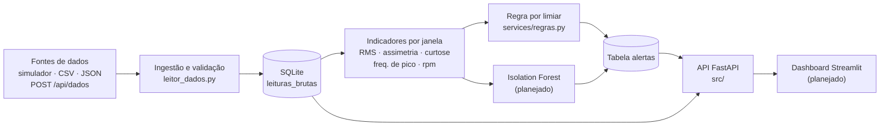
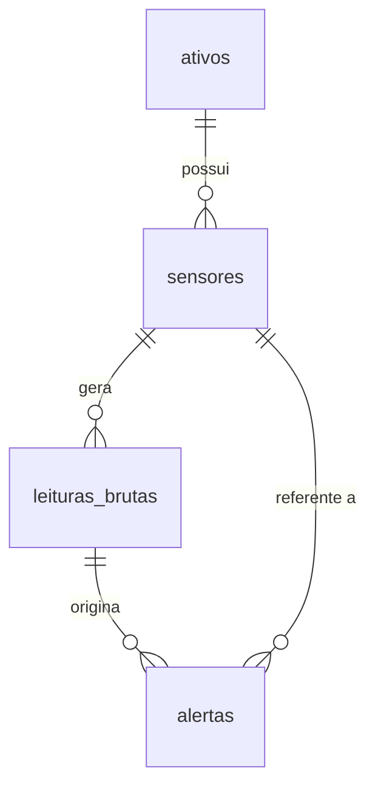

# 🛠️ Sistema Inteligente de Diagnóstico Preditivo de Falhas Mecânicas

> **Empresa:** ArcelorMittal / Tuper

---

## Equipe

- **Ederlane Ciribelle Silva Fernandes**
- **Iran Andrei da Costa**
- **Paulo Ricardo Wosniak Soares**

---

## Visão Geral

O **Sistema Inteligente de Diagnóstico Preditivo** é uma solução voltada para a indústria com o objetivo de otimizar rotinas de manutenção preditiva e evitar paradas não planejadas em linhas de produção.

O sistema recebe dados de vibração e rotação de máquinas industriais (motores e compressores), calcula indicadores estatísticos e aplica regras e Inteligência Artificial para identificar comportamentos anômalos que indicam desgaste mecânico ou iminência de falha. Os resultados são exibidos em um painel web com status por cores.

> No MVP os dados são **sintéticos**, gerados por um simulador (`mock/`), e o painel é atualizado a partir do banco de dados (não há conexão direta com os sensores da planta).

## Objetivo Geral

Desenvolver uma aplicação capaz de analisar dados de sensores de vibração, detectar anomalias em equipamentos industriais e emitir alertas preditivos categorizados (🟢 Normal, 🟡 Atenção, 🔴 Crítico), auxiliando na redução de custos e na prevenção de falhas graves em componentes mecânicos.

---

## Status do Projeto

| Componente | Status | Onde |
|---|---|---|
| Simulador de dados de vibração (lote e *stream*) | ✅ Pronto | `mock/simulator.py` |
| Modelagem do banco (SQLite, 4 tabelas) | ✅ Pronto | `mock/schema.sql` |
| Leitura e validação dos dados (SQLite/CSV/JSON) | ✅ Pronto | `mock/leitor_dados.py` |
| API FastAPI (`/health`, `/api/exemplo`, `POST /api/dados`) | ✅ Pronto (scaffold) | `src/` |
| Regra de diagnóstico por limiar (ISO 10816 adaptada) | ✅ Pronto (ainda não exposto na API) | `services/regras.py` |
| Detecção de anomalias com Isolation Forest | 🔜 Planejado | experimento em `mock/leitor_dados.py --detectar` |
| Salvar/carregar o modelo treinado (`joblib`) | 🔜 Planejado | `modelos_treinados/` |
| Dashboard web (Streamlit) | 🔜 Planejado | `dashboard/` |

---

## Arquitetura



**Fluxo:** ingestão → indicadores → detecção (regra + Isolation Forest) → alertas → API → dashboard.

Cada linha de `leituras_brutas` representa **uma janela de vibração já reduzida a indicadores** (RMS, assimetria, curtose, frequência de pico). O simulador usa janelas de 1024 amostras a 2048 Hz.

**Camadas da API** (`src/`): `routes` (HTTP e validação Pydantic) → `controllers` (regras de aplicação) → `models` (consultas SQL) → `database` (conexão SQLite).

---

## Stack

| Camada | Tecnologia |
|---|---|
| Linguagem | Python (testado com 3.13) |
| Backend / API | FastAPI + Uvicorn |
| Banco de dados | SQLite |
| Análise e ML | pandas, NumPy, scikit-learn (`IsolationForest`) |
| Persistência do modelo | `joblib` (arquivo `.joblib` em `modelos_treinados/`) |
| **Interface** | **Streamlit consumindo a API FastAPI via HTTP** |
| Testes | `unittest` |

> A interface foi definida como **Streamlit**: ele lê os dados pela API (`/api/...`) em vez de acessar o banco diretamente, mantendo o backend como única porta de entrada. Ao implementar o dashboard, incluir `streamlit` e `requests` no `requirements.txt`.

---

## Estrutura de Pastas

```
.
├── Readme.md
├── AI_LOG.md                  # histórico do uso de IA no projeto
├── requirements.txt           # dependências da API e do ML
├── .env.example               # modelo de configuração (copiar para .env)
├── .gitignore
├── src/                       # API FastAPI
│   ├── main.py                # cria o app, inicializa o banco e registra as rotas
│   ├── config.py              # lê o .env (PORT, DATABASE_PATH, SCHEMA_PATH)
│   ├── database.py            # conexão SQLite, init_db(), ativos e sensores iniciais
│   ├── routes/                # health.py, dados.py
│   ├── controllers/           # health_controller.py, dados_controller.py
│   └── models/                # leitura.py (consultas SQL)
├── services/
│   └── regras.py              # diagnóstico por limiar (NORMAL / ATENCAO / CRITICO)
├── mock/                      # dados e simulador (ver mock/README.md)
│   ├── schema.sql             # modelagem do banco
│   ├── simulator.py           # gerador de leituras de vibração
│   ├── leitor_dados.py        # leitura e validação dos dados
│   ├── validar.py             # relatório de verificação
│   ├── test_mock.py
│   ├── test_leitor.py
│   ├── requirements.txt
│   └── data/                  # ativos.csv, sensores.csv, leituras_brutas.csv/.json
│                              # vibracao.db é gerado localmente (não versionado)
├── dashboard/                 # (planejado) app Streamlit
└── modelos_treinados/         # (planejado) modelo Isolation Forest salvo
```

---

## Como Rodar

**Pré-requisito:** Python 3 com `pip`.

```bash
# 1. clonar
git clone https://github.com/iranCosta/Projeto-Aplicado-II.git
cd Projeto-Aplicado-II

# 2. ambiente virtual
python -m venv venv
source venv/bin/activate          # Linux/macOS
# venv\Scripts\Activate.ps1       # Windows (PowerShell)

# 3. dependências
pip install -r requirements.txt

# 4. configuração (opcional: já existem valores padrão)
cp .env.example .env              # Windows: copy .env.example .env
```

**Gerar os dados de teste** (cria `mock/data/vibracao.db`):

```bash
cd mock
python simulator.py               # 3000 leituras, semente 42 (reprodutível)
cd ..
```

**Subir a API** (a partir da raiz do projeto):

```bash
uvicorn src.main:app --reload
```

A API fica em `http://localhost:8000` e a documentação interativa em `http://localhost:8000/docs`. Se o banco ainda não existir, as tabelas são criadas automaticamente na inicialização (sem leituras).

**Testar:**

```bash
curl http://localhost:8000/health
curl "http://localhost:8000/api/exemplo?limite=5"
```

**Rodar os testes automatizados:**

```bash
cd mock
python -m unittest test_mock test_leitor -v
```

### Endpoints

| Método | Rota | Descrição | Respostas |
|---|---|---|---|
| GET | `/health` | Verifica a conexão com o banco | `200` saudável · `503` banco indisponível |
| GET | `/api/exemplo?limite=10` | Últimas leituras (`limite` de 1 a 100) | `200` |
| POST | `/api/dados` | Insere uma leitura | `201` criada · `422` dados inválidos |

Exemplo de corpo do `POST /api/dados`:

```json
{
  "sensor_id": 1,
  "timestamp": "2026-10-22T20:00:00Z",
  "rms": 1.53,
  "assimetria": 0.18,
  "curtose": 3.0,
  "frequencia_pico": 30.0,
  "rotacao_rpm": 1780,
  "status_alerta": "NORMAL"
}
```

---

## Esquema do Banco de Dados (`mock/schema.sql`)



| Tabela | Colunas principais | Restrições |
|---|---|---|
| `ativos` | `id`, `tag` (ex.: MOT-101), `nome`, `tipo`, `localizacao`, `rpm_nominal` | `tag` única · `tipo` ∈ {MOTOR, COMPRESSOR} · `rpm_nominal` > 0 |
| `sensores` | `id`, `ativo_id`, `posicao` (ex.: LADO_ACOPLADO), `taxa_amostragem_hz` (2048), `unidade` (mm/s) | `ativo_id` → `ativos` |
| `leituras_brutas` | `id`, `sensor_id`, `timestamp` (ISO 8601 UTC), `rms`, `assimetria`, `curtose`, `frequencia_pico`, `rotacao_rpm`, `status_alerta`, `anomalia_real`, `tipo_anomalia` | `rms` ≥ 0 · `frequencia_pico` ≥ 0 · `status_alerta` ∈ {NORMAL, ATENCAO, CRITICO} · índice em (`sensor_id`, `timestamp`) |
| `alertas` | `id`, `leitura_id`, `sensor_id`, `timestamp`, `severidade`, `mensagem`, `reconhecido` | `severidade` ∈ {ATENCAO, CRITICO} · FKs para `leituras_brutas` e `sensores` |

> `anomalia_real` e `tipo_anomalia` são o **gabarito do simulador**: existem só no mock, para avaliar o detector. **Não devem ser usadas como feature** do modelo (vazamento de dados).

A curtose é guardada na forma não-excesso (distribuição normal ≈ 3).

**Critérios de status** (ISO 10816 adaptada, em `services/regras.py`):

| Status | Condição |
|---|---|
| 🟢 NORMAL | dentro dos limites |
| 🟡 ATENCAO | RMS ≥ 4,5 ou curtose ≥ 4 (ou RMS < 0,2: possível sensor travado) |
| 🔴 CRITICO | RMS ≥ 7,1 ou curtose ≥ 8 |

---

## Escopo do MVP

**Limite de esforço:** 42 horas de desenvolvimento.

**Dentro do escopo**

1. Ingestão de dados históricos/sintéticos (SQLite, CSV, JSON e `POST /api/dados`) com validação.
2. Indicadores por janela: RMS, assimetria, curtose, frequência de pico.
3. Classificação por regra de limiar e detecção de anomalias com Isolation Forest.
4. Dashboard web com semáforo (verde, amarelo, vermelho) por ativo/sensor.

**Fora do escopo**

- Conexão direta com CLP/sensores via **OPC-UA** ou **MQTT**.
- Envio de alertas por **SMS, WhatsApp** ou e-mail.
- Análise espectral completa (**FFT**); o MVP usa apenas a frequência de pico já calculada por janela.
- Classificadores supervisionados (não há base balanceada de falhas rotuladas).
- Autenticação e controle de acesso de usuários.

---

## Requisitos

### Funcionais

| ID | Requisito | Status |
|---|---|---|
| RF01 | O sistema deve ingerir leituras de vibração a partir de SQLite, CSV, JSON e `POST /api/dados`, rejeitando registros inválidos com o motivo. | Parcial |
| RF02 | O sistema deve disponibilizar, por janela, os indicadores RMS, assimetria, curtose, frequência de pico e rotação, e permitir consultar as últimas leituras. | Parcial |
| RF03 | O sistema deve classificar cada leitura como NORMAL, ATENCAO ou CRITICO por regra de limiar. | Pronto (módulo) |
| RF04 | O sistema deve detectar anomalias com Isolation Forest, sem depender de falhas rotuladas. | Planejado |
| RF05 | O sistema deve registrar um alerta na tabela `alertas` quando o status de um sensor piorar. | Planejado |
| RF06 | O dashboard deve exibir o status por cores de cada ativo/sensor e a lista de alertas. | Planejado |
| RF07 | A API deve expor `GET /health` informando a situação da conexão com o banco. | Pronto |

### Não funcionais

| ID | Requisito | Status |
|---|---|---|
| RNF01 | A resposta de uma inferência sobre o conjunto de dados do mock (≈ 5 mil leituras) deve levar menos de 3 s. | Meta |
| RNF02 | O projeto deve ser executável a partir de um clone limpo seguindo apenas este README; os dados do simulador devem ser reprodutíveis (`--seed`). | A validar |
| RNF03 | O modelo treinado deve ser salvo e carregado com `joblib`, sem retreinar a cada inicialização. | Planejado |
| RNF04 | Configurações e segredos ficam no `.env`; `.env` e `*.db` não são versionados. | Atendido |
| RNF05 | A lógica de leitura/validação e o simulador devem ter testes automatizados. | Atendido (`mock/`) |

---

## Limitações Conhecidas

- Os dados são sintéticos; a validação com dados reais da planta depende da disponibilidade fornecida pela empresa.
- Os limiares da regra são uma adaptação da ISO 10816, não calibrados para os ativos reais.
- O Isolation Forest ainda não está treinado nem integrado à API; hoje existe apenas um experimento comparativo em `mock/leitor_dados.py --detectar`.
- O endpoint `/api/exemplo` é provisório (consulta simples das últimas leituras).
- `services/regras.py` ainda não é chamado pela API e não possui testes próprios.

---

## Licença

Projeto desenvolvido para fins acadêmicos e de aplicação prática no contexto da ArcelorMittal / Tuper.
